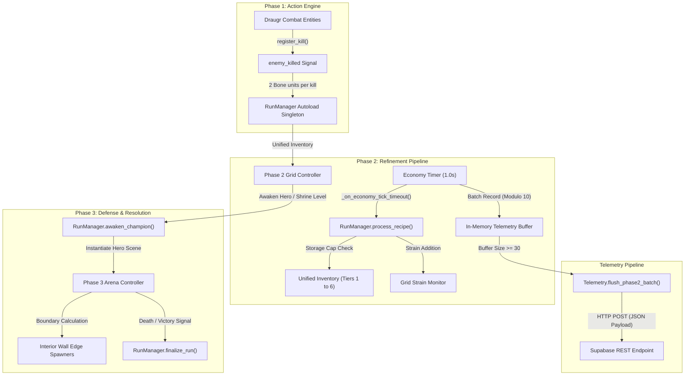

# Swiss Rolls (Project Vigrid)

An event-driven simulation engine and state machine that coordinates a 6-tier resource conversion pipeline, automated headless regression tests, and batched HTTP telemetry ingestion.

## Part 1: Overview

### The Business Case
In multi-stage simulation software, loose coupling between real-time action systems, resource conversion pipelines, and persistent cloud databases frequently results in state desynchronization, memory leaks, and network request drops. This system decouples phase execution into isolated scenes managed by an Autoload state machine, enforces backpressure on resource queues to prevent integer overflow, and batches telemetry transmissions to prevent HTTP timeout errors on external database endpoints.

### Tech Stack
* **Godot Engine 4.7.1 (GDScript)** - Core simulation loop, scene tree management, and 2D physics.
* **Python 3** - Scripted source code patching and AST text substitution.
* **Supabase / PostgREST** - Remote PostgreSQL telemetry ingestion and analytics storage.
* **HTTP / REST Client** - Asynchronous JSON metric transmission with custom headers and UUID generation.
* **WebAssembly (Wasm) & HTML5 / GLES3** - Browser runtime export targets.
* **Windows PowerShell / Command Shell** - Headless CI/CD test automation execution.

## Part 2: Architecture & Logic

### Data Flow



### Core Logic & Fault Tolerance

#### 1. Resource Refinement Pipeline and Backpressure Control (`RunManager.gd`)
The resource pipeline uses a 6-tier sequential conversion tree (Bone -> Stone -> Wood -> Amber -> Sap -> Seeds) governed by `ConversionRecipe` resource data objects. To prevent uncontrolled integer growth and inventory overflow, `process_recipe()` enforces a strict backpressure check before processing any transaction:
1. **Output Storage Validation**: The script checks `inventory[out_id] >= get_storage_cap()`. If storage is full, the transaction aborts immediately without deducting raw input resources.
2. **Input Inventory Validation**: The script verifies that available input balances satisfy `inventory[req_id] >= req_amount`. If requirements fail, the transaction returns `false`.
3. **Hardware-Timed Resource Decay**: When Tier 6 structures exist, `_on_rot_tick()` executes on a dedicated 5.0-second timer. It deducts `1 + current_cycle` bone per tick, using `max(0, current_bone - drain_amount)` to prevent negative inventory balances.
4. **Strain Threshold Protection**: Each conversion adds a fixed strain cost to `current_strain`. If `current_strain > max_strain`, the state machine emits `barrier_collapsed()`, transitioning the active scene to combat and halting all further production.

#### 2. Network Telemetry Batching and Request Throttling (`Telemetry.gd`)
The telemetry system records runtime statistics (kills, inventory balances, strain levels, and cycle times) to a remote Supabase PostgreSQL database via HTTP POST. 
* **Timeout Prevention**: Direct single-event HTTP transmission causes socket exhaustion, while end-of-run bulk dumps trigger Cloudflare/Supabase HTTP 522 Connection Timeouts. The script prevents both failure modes by queueing events into an in-memory array (`phase2_batch`) and triggering `flush_phase2_batch()` strictly when the array reaches 30 items.
* **Memory Leak Elimination**: Each flush programmatically instantiates an ephemeral `HTTPRequest` node, mounts it to the scene tree, and attaches a completion handler that executes `req.queue_free()`. This cleans up completed socket resources after every network response.
* **Minimal Network Overhead**: Requests transmit with the `Prefer: return=minimal` header, stopping the database from echoing back inserted records and saving bandwidth.
* **Offline Fallback**: If the endpoint URL contains the unconfigured placeholder string `"YOUR_SUPABASE"`, the logging functions abort immediately and clear internal buffers without raising network exceptions.

#### 3. Lineage Array Bounds Protection (`RunManager.gd`)
Hero archetypes track death counts through a `current_generation` dictionary. Pre-assigned lineage names exist in fixed-size arrays of 5 elements per class.
* If a player dies more than 5 times within an archetype, direct array indexing throws an out-of-bounds runtime exception.
* `get_current_hero_name()` prevents index faults with an explicit boundary guard: if `gen < names_list.size()`, it returns the static name. If `gen >= names_list.size()`, it computes an algorithmic fallback: `"Mortal Descendant " + str(gen - names_list.size() + 1)`.

#### 4. Spatial Bounds and Instance Validation (`Phase3Manager.gd`)
In Phase 3 combat, enemy spawning uses hard-coded spatial limits (`ARENA_MIN_X: 70.0`, `ARENA_MAX_X: 1210.0`, `ARENA_MIN_Y: 70.0`, `ARENA_MAX_Y: 615.0`).
* Instead of spawning entities off-screen where physics updates can desynchronize, the spawner assigns entities strictly to one of the four interior perimeter edges (`randi() % 4`). This keeps physics bodies within the inner boundaries of the collision wall tilemap.
* Frame updates in `_process()` wrap player node queries in `is_instance_valid(active_player)`. When a player entity is destroyed in combat, the engine avoids null-pointer dereferencing errors while cleaning up UI health bars.

#### 5. Character Encoding Sanitization (`tests/tier1_feature_tests.gd`)
To avoid UTF-8 decoding mismatches and font rendering errors across web export builds (Wasm/HTML5), all hero and lore identifiers undergo automated ASCII validation. The test runner loops through all character codes, asserting `c >= 0 and c <= 127` to reject non-ASCII byte sequences before deployment.

### Deployment & Execution

* **Automated Headless Test Runner**:
  Regression tests run headlessly through the Godot engine binary without launching a window:
  ```cmd
  Godot_v4.7.1-stable_win64.exe --headless res://tests/test_runner.tscn
  ```
  The test harness executes 252 assertions across 4 tiers (Feature Coverage, Boundary Conditions, Subsystem Interactions, and Campaign Scenarios). It emits a terminal summary and exits with code `0` on success or code `1` on failure, integrating cleanly into standard build pipelines.

* **Browser Web Target (Wasm / HTML5)**:
  Compiled to WebAssembly and static HTML5 (`swiss-rolls-web-build/` and `swiss-rolls-.0.5.2/`), utilizing web workers for audio worklet execution (`index.audio.worklet.js`) and GLES3/WebGL for rendering. Deployed by serving static assets over HTTPS.

* **Standalone Desktop Application**:
  Compiled to Windows 64-bit binaries via presets defined in `export_presets.cfg`.

